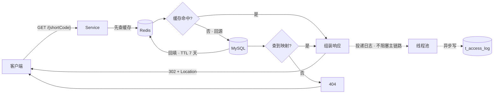
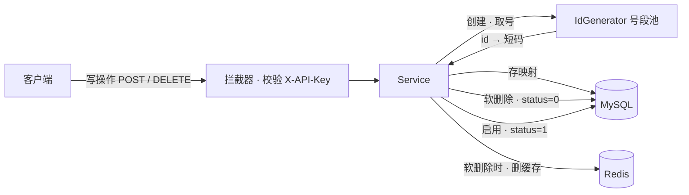

# shortLink(短链跳转项目)

## 项目简介          
一句话：把长链转成 6 位短码，支持高并发跳转
## 技术栈            
Spring Boot 4 / MySQL / Redis / 线程池异步
## 架构图           

## 核心设计
  - 短码生成   
    id × K mod 62^6  
    id由发号器通过对比Redis最大id号后发送，K是混淆乘数，防止有人恶意攻击，62^6中62是短链使用的字符种类数，是0~9数字加上大小写字母，6是短链长度。

  - 发号器  
    号段池，使用Redis记录最大id值，每次取号用当前号current和max对比，如果小于则取号，如果大于等于则取1000个号，max += 1000。
  - 跳转使用响应码302 而非 301    
    短链后端需要统计跳转访问情况，301响应浏览器会缓存跳转数据下一次访问直接跳，所以使用302临时跳转。

  - Cache-Aside     
    读先缓存、写后删缓存，TTL 7 天。

  - 异步统计        
    跳转不等写库，单次访问P99 从 86ms 降到 71ms
## 接口文档

[接口文档](shortLinkAPI.md)

## 本地运行 
依赖：JDK 17 / MySQL 8 / Redis
1. mvn clean package
2. 启动 Redis 与 MySQL，建表（见 sql/schema.sql）
3. java -jar target/shortlink-0.0.1-SNAPSHOT.jar

    
## 压测数据  

跳转主链路采用异步写日志。压测（100 并发 / 60s）显示：P99 从 86ms 降至 71ms，长尾（Max）从 860ms 降至 230ms。

